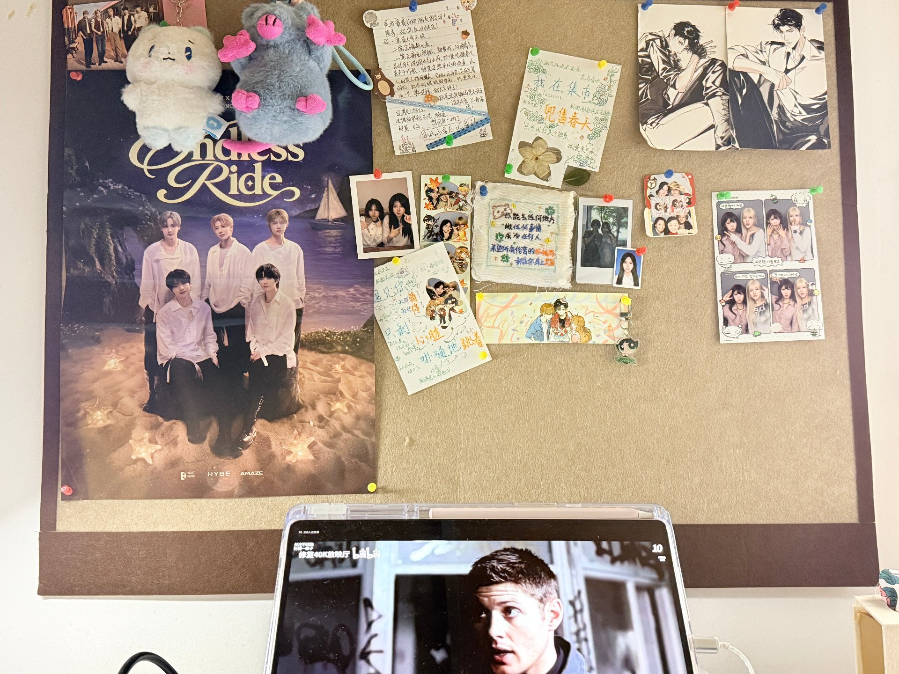

我的书桌正前方挂着一块毛毡板。起初它空着，像一块什么都没写的黑板；现在它满了，满到每往上钉一张新纸条都要先犹豫一下该摘掉哪一张。

## 上面都有些什么

- 左边是一张《Endless Ride》的海报，是最近循环最多的那张专；
- 海报上挤着两个玩偶，一只白色的小熊，一只蓝灰色的绒毛怪，耳朵是粉色的；
- 中间偏右是毛毡绣的小方巾，上面写着「做低纯名词，做高纯度的人」，一针一线都是朋友绣的；
- 散落着各种小纸条：某某老师的句子里摘的话、图书馆借书号、写到一半的灵感；
- 还有拍立得、贴纸、四宫格大头贴，以及一朵不知道什么时候夹进去的干花。

## 它为什么重要

因为抬眼就能看到。

写论文卡住的时候，抬头看一眼那些纸条——「我在集市，囤借春天」「做你最鄙的人，做你牵挂的人」——都是些没有逻辑的句子，但它们替我把「生活还在继续」这件事钉在了墙上。

> 一块板子的作用，不是收纳，是提醒。

## 下一步

毛毡板已经接近满了。我打算把它分成两半：左边留给「喜欢的东西」，右边留给「想成为的样子」。等右半边也贴满的时候，说不定就换一块更大的板子。

生活大概就是这样一格一格填满的吧。
