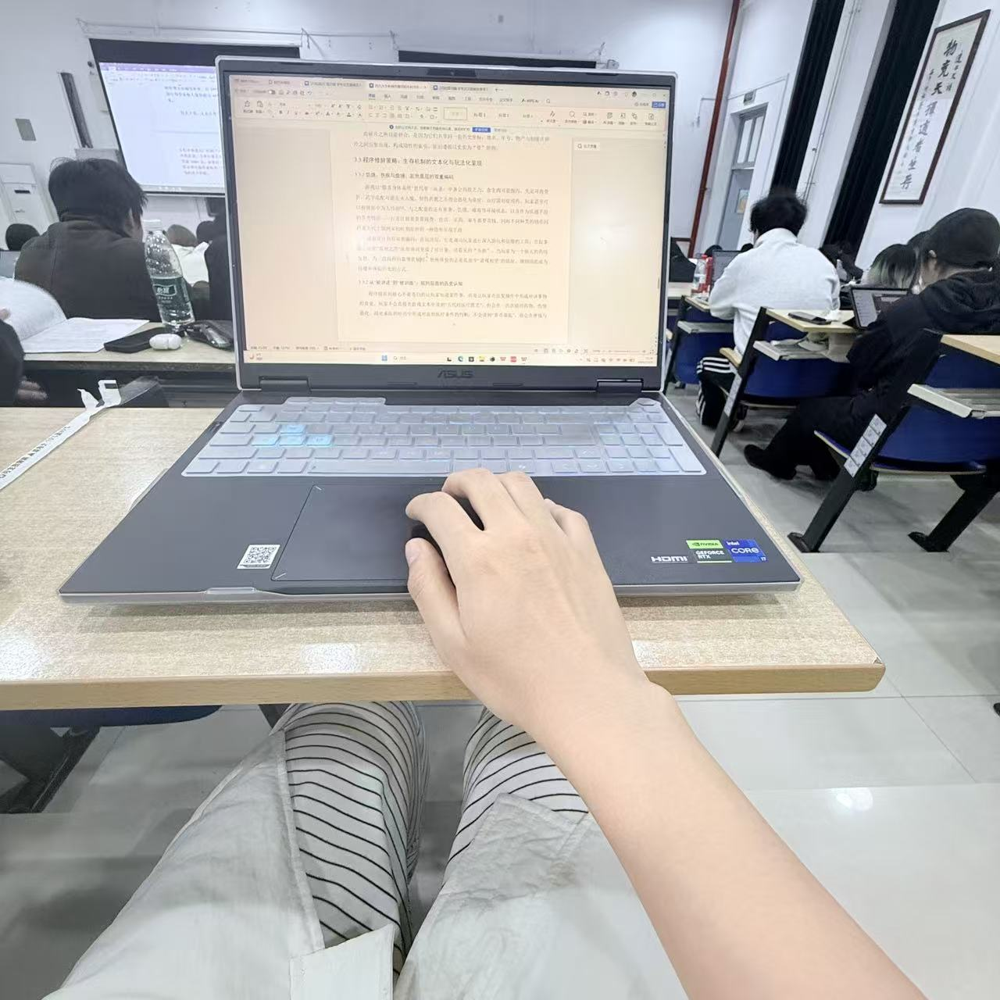

期末周又来了。今年决定不再靠考前一夜硬撑，于是做了点小实验。

这是实验进行到第三天的样子：笔记本电脑开着文档，光标一闪一闪，键盘上还罩着透明的膜。坐在教室里，周围全是同样在赶工的人——期末周的教室有一种奇妙的安静，大家各自埋头，空气里都是DDL的味道。

## 试过的方法

1. **番茄钟**：一开始很新鲜，后来每次响铃都打断思路，放弃。
2. **全天计划表**：排得密密麻麻，第一项没完成就全盘崩掉，放弃。
3. **手机锁盒**：有效，但盒子被我弄丢了。

## 最后留下的

最后只剩下一条：**每天只定三件最重要的事**。写在一张纸上，贴在桌上。做完一件划掉一件。

> 计划的价值不在精确，而在于让你知道今天该先做什么。

这个方法笨，但能坚持。一天结束看到三件事都被划掉，会有一种很朴素的满足感。

## 一点体会

时间管理说到底不是技术问题，是跟自己的谈判：

- 别把目标定成「理想中的自己」能做到的事，要定成「今天这个状态」也能做到的事；
- 允许某一天只完成两件，甚至一件；
- 完成之后真的去休息，别偷偷加任务。

期末还没结束，先写到这里。
