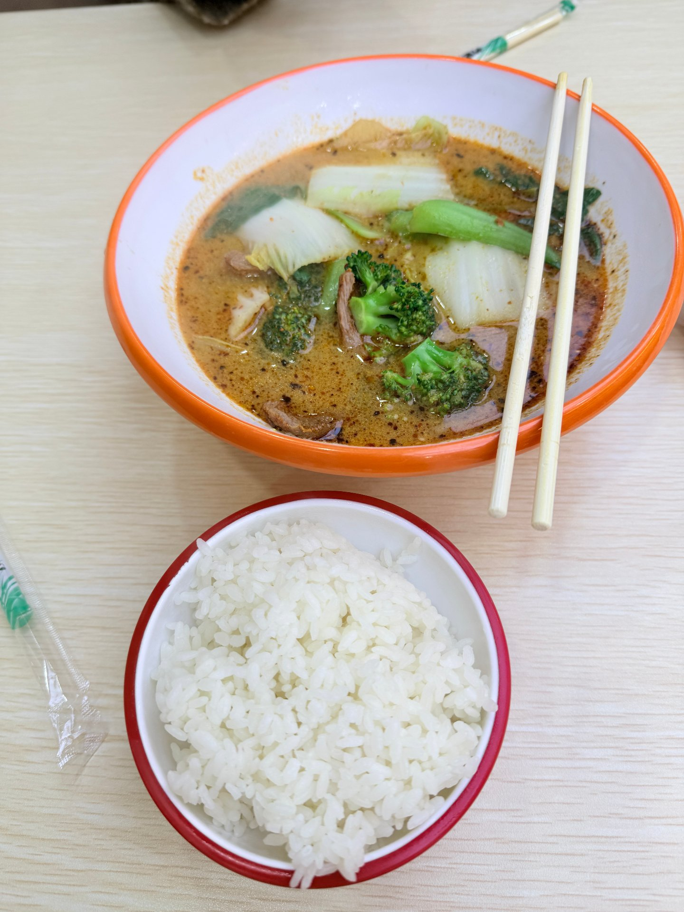

那天晚自习结束得晚，出教学楼已经快十点。校园里的灯少了一半，风从领口钻进来。

食堂快关门了，只剩一个窗口还亮着。阿姨问：「要汤吗？刚煮的。」

我说来一碗麻辣烫吧，再加一碗米饭。

端回来的时候汤还在冒泡：奶白的汤底上浮着一点红油，娃娃菜煮得透亮，西兰花绿得恰到好处，还有几片牛肉沉在底下。筷子搭在橙色的碗沿上，米饭盛在小碗里，热气把整个桌面都熏暖了。

## 一碗汤的时间

我端着碗坐在角落。第一口汤下肚，从喉咙一直暖到胃里，眼镜起了雾。等雾散开的时候，一整天绷着的那根弦，好像「啪」地一下松开了。

那几分钟里，我想的不是作业，也不是下周的安排，只是「好喝」。

> 有些幸福很小，小到只需要一碗热汤就能装下。

## 关于深夜的食物

深夜吃东西总带点罪恶感，但那天我觉得恰到好处。不是因为饿，而是因为一天的紧绷终于有了一个可以放下的地方。

回宿舍的路上，风好像也没那么冷了。

后来我又去过几次那个窗口。阿姨有时候会多给一勺汤底，我猜她记得我。有一回我说「不用多」，她摆摆手：「天冷，多喝点。」

你看，食物是最不会骗人的温柔。
